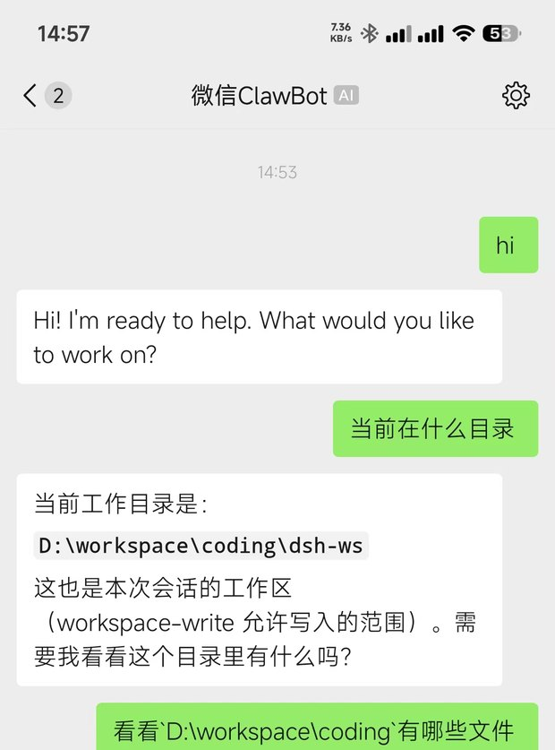
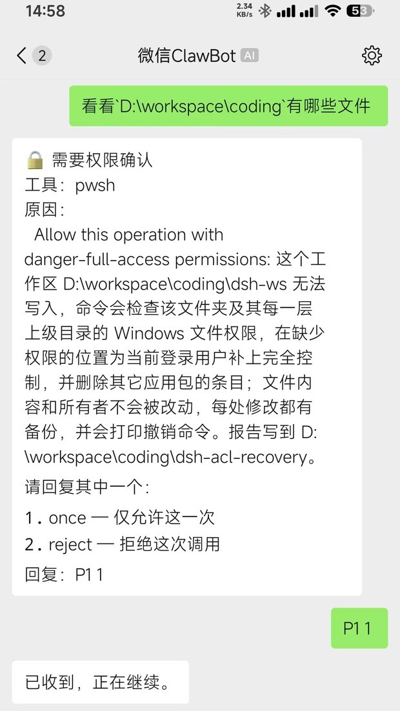
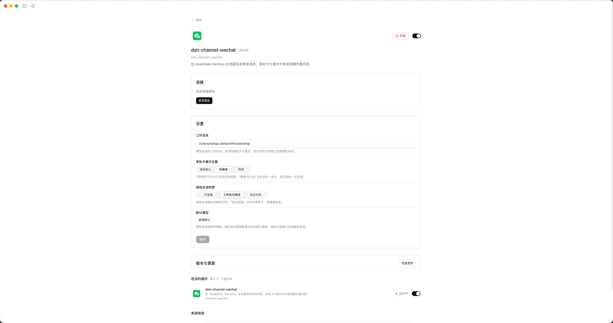

# dsh-channel-wechat

[English](./README.en.md) | 中文

[](https://www.npmjs.com/package/dsh-channel-wechat)
[](https://www.npmjs.com/package/dsh-channel-wechat)
[](https://github.com/wangx-wx/dsh-channel-wechat/actions/workflows/ci.yml)
[](./LICENSE)
[](https://github.com/deepseek-ai/deepseek-harness)

把微信（腾讯 iLink / ClawBot）接入 [DeepSeek Harness](https://github.com/deepseek-ai/deepseek-harness) 的通道插件。它以一个 npm 包同时提供 Harness bundle 和 GUI 浏览器端，运行在 Harness 进程内。

**这个插件的重点不是功能清单的长度，而是消息不丢。** 一轮结束时的回答才发出（旁白和工具参数不会被当成回答），超长正文按段落切开而不是整条被服务端拒绝，`ret: -2` 限流按 2s→4s→8s→16s 退避而不是重试三次后静默丢弃。这三条都有测试钉住，改坏时 CI 会失败。

| 微信里对话 | 微信里审批 | 插件页 |
|:--:|:--:|:--:|
|  |  |  |
| 直接在聊天里问、让它干活，回复回到微信 | 审批卡和提问卡转发到微信，回复编号即可 | 扫码登录、工作目录、卡片投递位置、权限、模型 |

## 能做什么

- 微信文本、图片、文件等消息与 DSH 双向收发。
- 微信消息进入 DSH 会话，回复从 `session/event` 回到微信。
- 微信内置命令（`/help`、`/skills`、`/cwd`、`/models`、`/model`、`/status`、`/stop`、`/new`）、审批卡和提问卡。
- 只有扫码登录的那个微信号能驱动这个机器人；其他人发来的消息不建会话、不执行命令、也不回复。
- `/cwd <绝对路径>` 在微信里切换工作目录：结束当前会话，在新目录开始新对话，切换跨重启保留。
- 审批卡可直接把当前会话切到完全权限；生成期间微信显示「对方正在输入」。
- 提问卡的答案可以是选项编号，也可以是你自己写的话；卡片上的 `0` 表示「换到对话里说」，整张卡随即作废。
- 多张卡片同时出现时一次只显示一张（标题带「第 N/M 张」），答完当前这张再发下一张；`/stop` 会一次性作废该会话所有待确认的卡片。
- GUI 插件页扫码登录、退出登录、配置工作目录、卡片投递方式、模型和权限。
- 长轮询与会话处理解耦；诊断写入终端和插件日志。

群聊、运行期多账号、主动推送和独立权限系统不在当前范围内。

## 环境要求

| 组件 | 要求 |
|---|---|
| Node.js | `^22.19.0` 或 `>=24.0.0` |
| pnpm | 11（仓库声明 `pnpm@11.7.0`） |
| DeepSeek Harness | `>=0.2.0-rc.1` |

安装门槛来自 `package.json` 的 `engines`；已验证版本和未验证范围见 [兼容性说明](./docs/compatibility.md)。

## 快速开始

1. 确认 profile 已有一个你希望用于微信会话的工作目录。
2. 安装插件并重启 DSH：

   ```bash
   dsh plugin --profile <你的 profile> add dsh-channel-wechat
   ```

3. 打开 GUI 的 **Plugins → dsh-channel-wechat**，点击登录微信，使用手机扫码；需要验证码时在页面输入。
4. 从微信向 bot 发一条消息，确认 DSH 回复返回微信。

安装后必须完全退出并重启 DSH，宿主才能发现浏览器端配置页。刚发布版本若被 pnpm 的观察期跳过，可使用：

```bash
dsh plugin --profile <你的 profile> add dsh-channel-wechat@latest --config.minimumReleaseAge=0
```

## 配置

GUI 页面可编辑全部配置。也可以在 profile 的 `cordis.patch.yml` 中写：

```yaml
- id: channel-wechat
  config:
    cwd: /你的/工作目录
    cards: wechat
    provider: ''
    model: ''
    permission: workspace-write
```

`cwd` 必须是绝对路径；它在会话创建时写入且不可变，修改只影响之后的新会话。完整字段、默认值和权限边界见 [配置参考](./docs/configuration.md)。

`allow` 决定谁能用这个机器人。留空时只放行扫码登录的那个账号，这是零配置的默认值；要授权别人，在插件页的「允许使用的人」里一行填一个微信 id。填入名单后**以名单为准**，登录者不再自动包含——被拒的消息不会回复，只在插件日志里留一行带对方 id 的记录，那个 id 就是填进名单的值。

没有 web app 的 profile 可以使用终端登录：

```bash
dsh <profile> login
dsh <profile> status
dsh <profile> logout
```

web/desktop profile 的启动器会先拒绝 `login` 位置参数，请改用 GUI 登录。

## 数据与日志

| 内容 | 位置 |
|---|---|
| 会话记录 | `~/.dsh/sessions/<cwd 转义>/channel-wechat-<peerId>[~g<N>]/session.v4.jsonl.zstd` |
| 插件状态 | `~/.dsh/channel-wechat/` |
| 诊断日志 | `~/.dsh/channel-wechat/log/channel-wechat-YYYY-MM-DD.log`，保留 7 天 |
| 登录凭证 | `~/.dsh/.credentials.yaml` |

聊天记录由 DSH 持久化，`/new` 只创建新的会话代次，不删除旧记录。排障时不要分享 token、Cookie 或凭证文件内容。

## 常见问题

- **插件页没有配置区**：完全退出并重新打开 DSH，见 [故障排查](./docs/troubleshooting.md)。
- **登录命令报参数错误**：web/desktop 只支持 GUI 登录。
- **消息没有回复**：先查插件日志、账号状态和 `cwd` 是否为绝对路径。
- **引用或媒体降级为文本**：部分引用字段和服务端 uint64 消息 id 是已记录限制，详见故障排查。

## 文档索引

### 用户指南

- [安装方式补充](./docs/installation.md)
- [微信内命令](./docs/commands.md)
- [实践文章：一个通道插件里失败时不报错的坑](./docs/article/wechat-channel-internals.html)
- [配置参考](./docs/configuration.md)
- [兼容性与验证范围](./docs/compatibility.md)
- [故障排查](./docs/troubleshooting.md)

## 获取帮助

请先查看[故障排查](./docs/troubleshooting.md)和插件日志。仍未解决时，请在 [GitHub Issues](https://github.com/wangx-wx/dsh-channel-wechat/issues) 提供 DSH 版本、插件版本、profile 类型、复现步骤和脱敏日志；不要提交 token、Cookie 或凭证文件。

### 开发与设计

- [开发与验证](./docs/development.md)
- [架构概览](./docs/architecture.md)
- [已交付能力](./docs/milestones.md)
- [实施方案与决策台账](./docs/plan-v1.md)
- [不变量说明](./docs/invariants.md)
- [协议文档](./docs/protocol/protocol_zh_CN.md)
- [需求规格](./spec/)
- [侦察报告](./docs/recon/)
- [开发日志](./docs/dev-log/)
- [发布流程](./docs/release.md)
- [贡献指南](./CONTRIBUTING.md)

## 贡献与维护

欢迎通过 [GitHub Issues](https://github.com/wangx-wx/dsh-channel-wechat/issues) 报告问题或提出建议，也可以提交 Pull Request。提交前请阅读 [开发与验证](./docs/development.md)，并运行构建、类型检查和相关测试。项目维护者与仓库信息见 [GitHub repository](https://github.com/wangx-wx/dsh-channel-wechat)。

## 本地开发

```bash
pnpm install
pnpm build
pnpm typecheck
pnpm test
pnpm test:integration
```

集成测试使用隔离的临时 `DSH_HOME`，默认寻找本地 DeepSeek Harness checkout；需要时设置 `DSH_CHECKOUT=/path/to/deepseek-harness`。详细说明见 [开发与验证](./docs/development.md)。

## 许可证与第三方声明

本项目使用 MIT，第三方代码和完整版权声明见 [LICENSE](./LICENSE) 与 [THIRD_PARTY_NOTICES.md](./THIRD_PARTY_NOTICES.md)。协议实现参考腾讯的 [`openclaw-weixin`](https://github.com/Tencent/openclaw-weixin)。

## 友链

- [LINUX DO](https://linux.do) — Where possible begins
